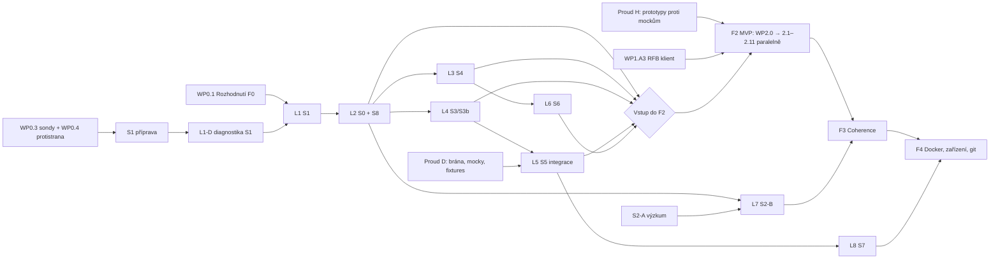

# Sanďbox — implementační plán

Tento dokument převádí [PLAN.md](../PLAN.md) na pracovní balíky, které lze dělat paralelně.
**PLAN.md je autoritativní kontrakt** (požadavky R1–R8, threat model, brány S0–S8, akceptace).
Při rozporu platí PLAN.md; tento dokument se opraví.

- Postupy a pravidla práce: [GUIDE.md](GUIDE.md)
- Stav požadavků, bran, testů a balíků: [COVERAGE.md](COVERAGE.md)
- Rozhodnutí F0: [DECISIONS.md](DECISIONS.md)
- Laboratoř, přijatá metodika a šablony: [LAB.md](LAB.md)
- Výsledky bran F1: [spikes.md](spikes.md)

## 0. Co dál

**Revize 2026-11-14, podklad `main` na `4ad05d9` po merge H4 [#79](https://github.com/Fir3st/sanjbox/pull/79), A3 [#78](https://github.com/Fir3st/sanjbox/pull/78) a dílčího A6 [#77](https://github.com/Fir3st/sanjbox/pull/77).**
[COVERAGE §4](COVERAGE.md#4-pracovní-balíky) vede stav a vlastníky; tato sekce určuje další krok.
F0 má **5/5 hotových balíků**, F1 **22 hotových / 5 rozpracovaných / 9 nezahájených**.
H4 je hotový a sloučený offline prototyp H1 policy adaptéru. A3 #78 je sloučeno jako `8faf648`:
přidává bounded S5 record kodeky a čtení ServerInit/SessionInfo s odmítnutím před volbou relace;
**neuzavírá A3**. Type-30 DH provider, reviewovaná politika virtuální autorizace a integrovaný
command/result tok chybí. A6 #77 je sloučeno jako `4ad05d9` a dodává
[fuzzer skutečných H1 helper/reply/broker v1 kontraktů](../spikes/s8-signing/A6-H1-FOLLOWUP.md),
syntetickou host-only autorizační hranici a šest dry-run restart/cleanup workflow. **Neuzavírá A6**:
SG-06 positive attach control, nativní autorizace daemonu, durable registration ownership/cleanup
přes restart a skutečné uživatelské podpisy zůstávají otevřené. Zelený wire fuzzer neověřuje XPC/Mach/TCC.
Všech **10 bran F1 a 155 akceptačních případů zůstává Neověřeno**. Dokončený prototyp ani zelené CI
nejsou laboratorní důkaz. Pět rozpracovaných balíků tvoří A2/A3/A6, D5 čekající na rozhodnutí a zmrazený G2.

**Když agent dostane „co teď dělat“:**

1. Ověř aktuální `main`, řádek balíku v COVERAGE a otevřené PR. Neintegrovaný stav větve ani pořadí
   v plánu nedokazují volný balík; vlastníci níže zůstávají platní.
2. **H1–H6 jsou hotové offline a sloučené; H4 #79 je v `main` jako `41d6f65`.**
   Nezadávej další H přípravu bez konkrétního nálezu a vymezené podmínky dokončení.
3. **Navazuje již obsazená příprava A2/A3/A6** podle tabulky níže. Sloučené dílčí A3 #78 a A6 #77
   nejsou hotové balíky. V A6 je H1 wire fuzzer dodaný; pokračování musí řešit konkrétní
   chybějící nativní cestu nebo SG-06 control, nikoli přidávat další obecný mock. Pokračuj v přidělené
   práci, nebo nejprve dohodni vymezené předání podle [GUIDE §5](GUIDE.md#5-paralelní-práce);
   vlastníci mohou pokračovat paralelně ve svých adresářích. Případnou změnu H1 koordinuj se všemi
   jeho klienty. Každou dosud otevřenou integrační větev uzavři až po kontrole aktuální base,
   přesného headu a CI; historické zelené kontroly nejsou potvrzení dnešního stavu.
4. Bez takového předání tu není nový volný implementační balík kritické cesty. Ohlas konkrétní
   čekání na U0/U1 nebo rozhodnutí U4/U5; neotvírej hotovou přípravu ani D5/G2 jen kvůli čekání.
   Skutečná integrace WP2.x stále čeká na laboratorní brány. WP1.F1 (Coherence) vyžaduje TCC grant a
   není náhradní úkol kritické cesty.

### Práce agentů nyní — pokračování již obsazených balíků

Vlastníci zůstávají podle COVERAGE. Tabulka vymezuje zbytek práce; převzetí ani souběžnou změnu
sdíleného rozhraní nepovoluje sama. Dokončení zahrnuje výstup, dokumentaci, cílené testy a aktualizaci
COVERAGE podle [GUIDE §8–11](GUIDE.md#8-definice-hotového); pro odblokování dalšího balíku musí být
rozhraní a jeho ověření sloučené v `main`.

| Balík / vlastník | Konkrétní další krok | Podmínka dokončení | Závislost a hranice |
|---|---|---|---|
| **WP1.A2** — `spikes/s1-session/`; janfiedler / Codex + Astra | Zavřít zbývající instrumentaci: úplnou a jednoznačnou atribuci UID/WindowServeru a kalibrovaný recorder start/ready; navázat na [existující sběr potomků](../spikes/s1-session/DESCENDANT-MEMORY.md). | **Příprava** končí, když každý řádek [LAB §8](LAB.md#8-připravenost-a2-a-mapování-s1) má nástroj ověřený na známém syntetickém výsledku, nebo předepsaný ruční záznam tam, kde ho metodika dovoluje; nechybí orchestrace hosta a tří relací s oddělenými výstupy. **Celý A2** končí až protokolem a reviewed verdiktem S1 z L1. | WP0.3/A1 jsou hotové. Lokální sběr vlastních potomků není úplná atribuce ani tři skutečné relace; jemné intervaly/RAM nelze nahradit ručním odhadem. Po uzavření přípravy čekat na L1, nepřidávat další offline evidence bez konkrétní mezery. |
| **WP1.A3** — `spikes/s1-rfb/`; janfiedler / Codex + Astra; navazující Astra review #78 | Po částečném [#78](https://github.com/Fir3st/sanjbox/pull/78) zbývají vlastníkovi dvě vymezené části: zvolit a reviewovat backend pro S4 finite-field DH/MD5/AES se syntetickými known-answer vektory; doložit a reviewovat povolení virtuální volby, pak zapojit S5 command/result s pending/denial, deadline, společným message budgetem a bez konzolového fallbacku. [Nově připnutý `session-select.js`](../spikes/s1-rfb/SOURCES.md) testuje console bit, ale virtual command 2 vrací bez kontroly masky; toto obejití není autorizační pravidlo. | Původní podmínka zůstává: Apple auth se syntetickými údaji a integrované délkově rámované S5 selection records jsou implementované a ověřené fixtures včetně odmítnutí konzolového fallbacku; dokumentace odděluje zdrojový kontrakt od hypotéz. Pouhé injekční crypto rozhraní, samostatné kodeky a terminální odmítnutí po SessionInfo ji nesplňují. **A3 zůstává rozpracované.** | Offline doplnění nečeká na lab, ale žádný backend či serverový kontrakt se nepředpokládá. Živá interoperabilita, server identity/confidentialita a přesná vazba UID/audit session čekají na [LAB-NEXT](../spikes/s1-rfb/LAB-NEXT.md) a následné review. L1-D může použít Screen Sharing.app a nečeká na vlastní RFB klient. |
| **WP1.A6** — `spikes/s8-signing/`; janfiedler / Codex + Astra; navazující Astra (nezávislé review #77) | [#77](https://github.com/Fir3st/sanjbox/pull/77) dodává H1 wire fuzzer, syntetickou daemon autorizaci a šest dry-run recovery workflow; [nezávislá validace](../spikes/s8-signing/VALIDATION.md#nezávislé-integrační-review-po-h4-a-a3--2026-11-14) ověřuje jejich omezený rozsah. Vlastník nyní doplní nativní host-only/admin approval adaptér, trvalé vlastnictví registrace a bezpečný úklid přes UI/login/reboot, potom kalibrovaný SG-06 attach runner podle konkrétních kroků níže. | H1 wire část je dodaná. Zbývá přezkoumaný native workflow pro všechny tři služby, Personal Team a podmíněnou self-signed variantu, včetně původního stavu a úklidu celého L2 scénáře; SG-06 musí mít srovnatelnou pozitivní i negativní kontrolu bez `get-task-allow`. Teprve pak je dokončená příprava A6; samotné S8 uzavírá A7/L2 s reviewed důkazy. | H1 je v `main`; [podpisové předání](../spikes/s8-signing/HANDOFF.md) už existuje. Skutečné podpisy a S1/L2 patří uživateli. Po handoffu cleanup odmítá unknown registraci; mock `cleaned`, shodný service status ani UUID nejsou oprávnění k registraci/unregister/odstranění app. **A6 zůstává rozpracované.** |

**Konkrétní pokračování A6 — dosavadní vlastník janfiedler / Codex + Astra:**

1. **Nativní autorizační a recovery cesta [implementátor, nezávislé review].** Navázat host identitu
   na OS audit token, běžící podpis a session/process generation; oddělit jednorázové host/admin
   schválení od dat oblasti. Pro LoginItem/Agent/Daemon dodat durable intent/result a vazbu
   run/app/service/owning UID/signed inventory mimo dočasný root. Otestovat přerušení i drift při
   UI restartu, loginu a rebootu bez automatické adopce; stejný SMAppService status neurčuje generaci
   registrace. Cleanup musí ověřit unregister, nulu vlastních helperů a nepřítomnost relaunch před
   odstraněním přesně vlastních artefaktů. Dokud tato přezkoumaná cesta chybí, restart/daemon
   registrační experimenty jsou blokované; nový syntetický receipt je neodblokuje.
2. **SG-06 [implementátor; uživatel pro případnou systémovou autorizaci].** Nejprve doložit pozitivní
   attach control se stejným mechanismem, caller signing, UID/session jako negativní hardened
   target, bez zakázaného entitlementu. Self task port ani `PT_TRACE_ME` jiného mechanismu nestačí.
   Pak doplnit child PID/start-identity binding, deadline a ověřený terminate/reap. Bez pozitivní
   kontroly nelze neúspěšný attach vyhodnotit jako ochranu agenta.
3. **Podpisy a živý oracle [uživatel + implementátor, A7/L2 až po S1].** Ověřit skutečný Personal
   Team podpis všech čtyř targets a kompatibilitu s úzkým Mach-O/inventory preflightem; self-signed
   použít jen po doloženém neúspěchu SG-04. Předem rezervovat L2 a cleanup, pak samostatně měřit tři
   služby, admin approval, TCC/rebuild a restart. XPC transport, skutečná Mach práva a helper
   symlink/TOCTOU potřebují nativní sondy; offline H1 metadata je nenahrazují. Zapsat nový laboratorní
   protokol a nechat review vyhodnotit SG případy; žádný z těchto kroků #77 neprovedlo.

### H3, H4 a H6 dokončeny offline — předání do F2

| Balík | Dokončený výstup a důkaz | Přesné předání |
|---|---|---|
| **WP1.H3** — `proto/cli/` | [PR #75](https://github.com/Fir3st/sanjbox/pull/75), sloučeno jako `e21c31d`: pět příkazů přes anonymní NSXPC k same-process mock helperu, H1 decode/korelace, doslovné argv, timeout/disconnect bez retry a paměťová restore unit. [Validace](../proto/cli/VALIDATION.md): 34/34 testů v Debug i Release; `accepted` je pouze execution handle. | Offline podmínka je splněná. [WP2.7](../proto/cli/README.md#předání-do-wp27) čeká na vstup F2, autentizovaný nativní helper a skutečné procesy/PTY/UID/APFS; další mock vrstva se bez nálezu nepřidává. |
| **WP1.H4** — `proto/gateway/` | [PR #79](https://github.com/Fir3st/sanjbox/pull/79), sloučeno jako `41d6f65`: [H1 adaptér](../proto/gateway/H1-ADAPTER.md) vyžaduje přesné gate-ID bindings, řídí npm/PyPI/git/model v dispatchi i skutečném loopback listeneru a odmítá širší cíle/metody/limity; klíče jsou mock. [Validace a integrační review](../proto/gateway/VALIDATION.md): 117/117 testů a 5/5 CLI v Debug i Release. | Offline podmínka je splněná. WP2.5 po vstupu F2 převezme typované handlery a politiku, s WP2.1/2.4 napojí autentizovanou vazbu UID/session/oblasti a síťovou/bind policy; doplní skutečné klíče/scopes/revokace, durable audit, produkční lifecycle a TLS/trust. CLI zatím nepřijímá H1; Homebrew, více gate stejného typu, PyPI CDN na jiném hostu a model GET zůstávají odmítnuté. Společný upstream cap může zpřísnit větší gate; limity a živou integraci ověří L5. |
| **WP1.H6** — `proto/escape/` | [PR #76](https://github.com/Fir3st/sanjbox/pull/76), sloučeno jako `75f3b5d`: všech 155 ID s krokem/oraclem, osm same-user syntetických sond, 133 ručních a 14 nepodporovaných případů; skutečný lokální `sanjbox-counterpart` a H1 audit. [Review po integraci H3 a validace](../proto/escape/VALIDATION.md#review-po-integraci-h3--2026-11-14): 18/18 testů v Debug i Release, negativní/neúplné výsledky, přesné kanárky a úklid; úplný běh vrací exit 3 a všechny akceptace `unverified`. | Offline podmínka i integrace jsou splněné. [WP2.8](../proto/escape/README.md#předání-do-wp28) převezme katalog a oracle až po vstupu F2; skutečné UID/tři souběžné oblasti, nativní adaptéry, nezávislé síťové měření a laboratorní evidence dosud chybí. |

**Handoff dalšímu agentovi:** H4 #79 (`41d6f65`), částečné A3 #78 (`8faf648`) a dílčí A6 #77
(`4ad05d9`) jsou sloučené. A6 #77 uzavírá jen H1 wire follow-up. Další implementace A6 řeší
výše vymezené nativní/SG-06 mezery
u dosavadního vlastníka, A2/A3 mají vlastní neuzavřené kroky. Zachovej validační historii, všech
155 neověřených případů a původní autorství. A3 ani A6 se nepřeznačí na hotové kvůli dílčímu merge.
Bez předání neclaimuj cizí práci; neotvírej hotové H prototypy ani je nespojuj do běžící oblasti. D5 čeká
na U4, G2 zůstává zmrazené a skutečné sloty/systémové akce patří uživateli. Vstup F2 se nemění.

**Předání H2 po PR #74:** [API a pravidla obnovy](../proto/lifecycle/README.md) jsou hotová pro jednu
privátní fixture se společným deníkem všech mock oblastí. Rezervace UID vzniká před prvním efektem
a končí až potvrzeným cleanup; nejasný intent nebo drift blokuje společný alokátor. H3/H6 mohou
model použít pro syntetické kontroly lifecycle, ale není jejich další povinnou závislostí. H2
neobsahuje XPC helper, shell/PTY, snapshot/rollback ani B4 witness adapter. Nativní uživatele, APFS,
launchd, průběžný zákaz spuštění, whole-UID quiescence a obnovu přes reboot je nejprve nutné ověřit
v rozsahu S0/S4; jejich integraci převezme WP2.2 až po splnění vstupních bran F2. LC-06/LC-11 ani
S0/S4 tím nejsou ověřené. Bez konkrétního nálezu se další H2 příprava nezadává.

### Čeká na uživatele — laboratoř a rozhodnutí

| # | Nejbližší akce a podmínka dokončení | Co odblokuje / co neprokazuje |
|---|---|---|
| **U0 — připravit stroj** | Doplnit a potvrdit [LAB §2](LAB.md#2-registr-strojů-a-rezervace): aktuální konfiguraci/revizi, GPU, místo, zálohu s ověřenou obnovou, dry-run konkrétního commitu a proveditelný úklid; rezervovat L1-D a dokončit předregistraci. M1 `LAB-janfiedler-01/r1` je stále vedený jako nepřipravený a žádný slot není rezervovaný. | Připravený L1-D. Rozhodnutí F0.8 o dostupnosti M1 samo nepotvrzuje provozní připravenost. |
| **U1 — L1-D, pak L1** | Po U0 spustit diagnostiku podle [S1 README](../spikes/s1-session/README.md#běh-l1-wp1a2), kroky 0–4 a úklid 8; předem určit dílčí rozsah. Zapsat skutečné credentials, souběh tří relací s hostem, přežití bez klienta, akceleraci a ověřený úklid do nového protokolu a indexu `spikes.md`. Plné L1 teprve po dokončení přípravy A2 a předregistraci celé akceptace. | L1-D ověří proveditelnost, **neuzavírá S1**. Selhání souběhu/akcelerace znamená stop a nové rozhodnutí podle F0.6; fallback F0.6 se stálým klientem pokrývá pouze selhání přežití bez klienta. L2 se otevře až po S1 pass. |
| **U4 — Homebrew publication time (D5)** | Rozhodnout nad [uzavřenou rešerší a přesnými variantami](../spikes/s5-gateway/research/wp1-d5-publication-time/README.md#zbývající-rozhodnutí-a-pokrytí): přijmout současné odmítání bottle s neprokázaným časem, zadat konkrétní nový provider kontrakt včetně autority/scopes, nebo výslovně změnit cooldown kontrakt v DECISIONS. | Vymezí další D5 a HB-04/S5/S6. Commit date ani OCI `created` nejsou důvěryhodný čas publikace; nedoložený kandidát Packages REST není důkaz neexistence zdroje. Do rozhodnutí Homebrew zůstává fail-closed a D5 rozpracované; další neomezená rešerše se nezadává. |
| **U5 — rozsah L4 a bind policy** | Před C4/L4 vyřešit [otázky Q1–Q7](../spikes/s3-pf/ingress/BIND-POLICY.md#6-otevřené-otázky-pro-uživatele): kandidát host endpointů/proxy, same-zone loopback, devserver `HOST`/`PORT`, povolené experimentální mechanismy, vlastník rezervace portů a wildcard rozsah. Případnou změnu požadavků/kompatibility zapsat výslovně do DECISIONS; žádná není touto revizí schválena. | Umožní předregistrovat konkrétní L4 experimenty; C3 zůstává hotová příprava a S3/S3b neověřené. C3-T1 je zvlášť podnět k review technického zdůvodnění PLAN, nikoli souhlas s oslabením R2/R3. |

**U2 a U3 jsou uzavřené:** F0.8/LAB-v1 (P4/P5 upravené) a F0.7/C-003 byly rozhodnuté 2026-11-07
v [DECISIONS](DECISIONS.md#rozhodnuté-podotázky). Z F0.8 zbývá pouze Docker start/stop před S7.
Skutečné podpisy/TCC, účty/scopes/revokace a další sloty provádí uživatel po jejich závislostech;
schválená metodika není souhlas s konkrétním systémovým zásahem.

### Hotové balíky — neotvírat znovu bez konkrétního nálezu

| Balík | Splněná podmínka | Další práce patří do |
|---|---|---|
| **WP1.A4** | [Postupy všech 31 FS/ID/LC případů](../spikes/s0-boundary/LAB-PLAN.md): sonda nebo ruční krok s controls/oraclem, výstupem a úklidem. | L2: cross-session/TCC; FS-04/08/LC-11 mají navazující závislosti S4/S8/F2 podle runbooku. |
| **WP1.B2** | [Mode/ACL hardening](../spikes/s4-host/HARDENING.md) s dry-run, trvalým deníkem a úklidem vlastních nezměněných zásahů. | L3: skutečné zpevnění, host kompatibilita a uninstall. |
| **WP1.B4** | [APFS pilot planner](../spikes/s4-state/TOOLING.md) s dry-run, záznamem stavu, uživatelským předáním a úklidem. | L3: native APFS, oprávnění snapshotů, whole-UID admission/crash/reboot. |
| **WP1.C3** | [Bind policy](../spikes/s3-pf/ingress/BIND-POLICY.md) a [L4 scénáře](../spikes/s3-pf/ingress/LABPLAN.md) zapsané. | C4/L4: autentizace peeru, nezávislý capture, vynucení politiky; C3-T1 zůstává otevřený. |
| **WP1.H1** | [Offline kontrakty](../proto/contracts/README.md) a [validace](../proto/contracts/VALIDATION.md): helper/broker zprávy, lifecycle, síť, audit a úplný B3 report s parity testem. Žádná brána tím neprošla. | A6 #77 dodává přímý wire fuzzer; H2/H3/H4/H6 kontrakty již používají. Ve F2 je převezme WP2.0; offline testy neověřují nativní integraci. |
| **WP1.H2** | [Lifecycle nad H1](../proto/lifecycle/README.md): trvalý globální deník, mock celého UID, konzervativní obnova a cross-zone rezervace; [validace](../proto/lifecycle/VALIDATION.md) 37 testů v Debug/Release, 116 procesních crash hranic přes 24 kroků a všech 9 H1 crash bodů. | Lab S0/S4: důkazy admission interlocku, whole-UID a crash/reboot; WP2.2 po vstupu F2: integrace ověřených mechanismů do nativních adaptérů. LC-06/LC-11 zůstávají Neověřeno. |
| **WP1.H3** | [CLI nad H1](../proto/cli/README.md), [34/34 testů v obou sestaveních a nezávislé review](../proto/cli/VALIDATION.md); pět příkazů, bezpečné odmítnutí a pouze syntetický stav. | WP2.7 po vstupu F2: autentizovaný helper, nativní admission/UID, descriptor-relative kořeny, execution/stdio/PTY a skutečný snapshot/rollback. |
| **WP1.H4** | [H1 adaptér a běžící knihovní cesta](../proto/gateway/H1-ADAPTER.md), [117/117 testů v obou sestaveních](../proto/gateway/VALIDATION.md); odmítnutí neúplných nebo širších konfigurací, mock klíče, offline podmínka splněna. | WP2.5 po vstupu F2 a L5: autentizace klienta, produkční síť/klíče/audit/lifecycle a skutečné integrační důkazy podle předání výše. S5/GW a R2/R3 zůstávají Neověřeno. |
| **WP1.H5** | [Export prototyp](../proto/export/README.md): výběr, preview, bezpečná kopie, karanténa a audit s testy. | WP2.11: skutečná UID/ACL, konsolidace auditu a akceptace POS-09. |
| **WP1.H6** | [Katalog všech 155 případů a runner](../proto/escape/README.md), [18/18 testů v obou sestaveních](../proto/escape/VALIDATION.md); same-user fixtures, samostatná loopback protistrana, H1 audit a konzervativní vyhodnocení. | WP2.8 po vstupu F2: skutečné UID a tři oblasti, nativní sondy/adaptéry, úplné oracly a laboratorní protokoly. Žádný z 155 případů tím neprošel. |

A1, D6 a follow-up opravy common/CI jsou také sloučené, nikoli práce čekající na první review.
Úplný seznam hotových balíků je v COVERAGE §4. Nový nález může založit vymezený follow-up, ale samotné
čekání na lab není důvod k dalšímu rozšiřování ([GUIDE §11](GUIDE.md#11-kdy-přípravu-ukončit)).

### Odloženo a laboratorní závislosti

- **WP1.F1/F2 (Coherence):** mimo MVP, výzkum pro F3; WP1.F1 potřebuje uživatelský TCC grant,
  WP1.F2/L7 prošlé S0/S8 a WP1.F1. Není výplní volné kapacity kritické cesty.
- **G2/G3 (Docker):** G1 rešerše je hotová, G2 zůstává částečné a zmrazené. Obnovit až po rozhodnutí
  budgetu start/stop a vymezení runtime práce pro F4; G3/L8 navíc potřebuje S5 pass. C-002 beze změny.
- **WP2.x:** skutečná integrace čeká na S0, S1, S3/S3b, S4, S5, S6 a S8 pass. S2 ani S7 nejsou vstupem
  F2; izolované H prototypy tuto podmínku neobcházejí. F3/F4 mají své další brány podle §3.
- **Laboratoř:** po S1 následuje L2 (S0/S8); po S0 se větví L3 (S4) → L6 (S6) a L4 (S3/S3b) → L5 (S5).
  Nejde o povinný řetěz všech L1…L8. Na jednom stroji se sloty včetně úklidu nepřekrývají; přesné
  přípravy a předchůdci jsou v §3–4. Otevřené bezpečnostní blokátory z [COVERAGE §5](COVERAGE.md#5-otevřené-blokátory-plan-otevřené-blokátory)
  zůstávají otevřené, zejména ochrana nezávislá na pf; dokončená rešerše C2 ji neprokazuje.

## 1. Principy rozdělení práce

1. **Příprava je paralelní, laboratoř je sériová na každém stroji.** Psaní kódu, sond, skriptů, fixtures
   a mocků může běžet souběžně ve více větvích. Běhy, které mění systém testovacího Macu (uživatelé,
   Sdílení obrazovky, pf, `/opt`, ACL, TCC granty), probíhají na daném stroji po jednom v **laboratorních
   slotech** (§4). Systémové zásahy a úklid se nesmějí překrývat (PLAN §Postup F1). Vývojáři s vlastními
   Macy mohou běžet sloty souběžně, každý na svém stroji (F0.8).
2. **Výsledek platí pro konfiguraci, na které byl změřen.** Sanďbox cílí na obecný Mac (F0.8). Každý běh
   zapisuje konfiguraci stroje; brána prošla jen pro konfigurace, kde prošla. Výkonové brány se měří i na
   minimální podporované konfiguraci podle přijatého F0.8 v DECISIONS.md.
3. **Rozsah MVP podle F0:** CLI + jedno okno s plochou oblasti (C-001), bez Dockeru (C-002), data z oblasti
   ven jen řízeným exportem (F0.3). R4 a R6 zůstávají požadavky produktu pro F3/F4.
4. **Privilegované kroky spouští uživatel.** Agent připraví skript s výchozím režimem `--dry-run`, popisem
   změn, záznamem původního stavu a úklidem. Root operace z oblasti neexistují.
5. **Brána ≠ hotový balík.** Balík je hotový, když existuje jeho výstup (kód, skript, sonda). Brána je
   prošlá, až když důkaz splní akceptaci z PLAN.md. Coverage vede oba stavy zvlášť.
6. **Bezpečnostní fail blokuje závislou integraci.** Po failu pokračuje jen nezávislý výzkum bez skutečných
   dat (PLAN §Pořadí). Změna požadavku vyžaduje záznam v DECISIONS.md a výslovné rozhodnutí uživatele.
7. **Vlastnictví adresářů.** Každý balík má vlastní adresář; sdílené kontrakty (`spikes/common/`,
   `Contracts/`) se mění jen samostatným balíkem s review, aby paralelní větve nekolidovaly.

## 2. Role

| Role | Odpovědnost |
|---|---|
| **Uživatel** | Rozhodnutí F0, privilegované kroky v laboratoři, TCC granty, skutečné integrační důkazy (účty, scopes), schválení stahování cizích balíčků konkrétním příkazem, schválení změn kontraktu. |
| **Implementátor** (člověk nebo agent) | Kód, sondy, skripty s dry-run a úklidem, fixtures a mocky, vyhodnocení protokolů, aktualizace coverage. Nečte tajemství, nepouští `sudo`, nespouští nepřezkoumané balíčky. |
| **Reviewer** | Nezávislá kontrola výsledku brány proti PLAN.md (oracle, credentials sond, úplnost failure modes). Brána se neuzavírá bez review. |

## 3. Fáze a pracovní balíky

Značení: `WPx.y`. Sloupec **Paralelně** říká, s čím může balík běžet současně. **Lab** = potřebuje
laboratorní slot (§4). Stav balíků vede [COVERAGE.md §4](COVERAGE.md#4-pracovní-balíky).

### F0 — Rozhodnutí a základy (start okamžitě)

| ID | Balík | Výstup | Závislosti | Paralelně | Lab |
|---|---|---|---|---|---|
| WP0.1 | Rozhodnutí F0 (8 bodů z PLAN §F0) | Vyplněné [DECISIONS.md](DECISIONS.md) | — | vše | ne |
| WP0.2 | Repo, dokumentace, coverage | Tento repozitář, GUIDE, COVERAGE | — | vše | ne |
| WP0.3 | Společná sada sond `spikes/common/` | Swift knihovna + CLI `sanjbox-whoami`: ověření skutečného/efektivního UID/GID, skupin, audit session a bootstrap kontextu proti očekávání (nesoulad = neplatné měření); generátor syntetických kanárků; formát protokolu běhu | WP0.2 | WP0.4, WP0.5, S5 | ne |
| WP0.4 | Nezávislá protistrana (oracle) | `spikes/common` (`sanjbox-counterpart`): listener na řízeném hostu, který nezávisle zaznamenává přijaté kanárky/bajty (pro S3, S5, S7) | WP0.3 (formát) | WP0.3, S5 | ne |
| WP0.5 | Metodika měření a laboratoř | `docs/LAB.md`: registr testovacích strojů (model, čip, RAM, macOS + build, displeje, vlastník), minimální a referenční konfigurace, rezervace slotů per stroj, záloha před během, acceptance statistiky a délky testů (F0.8) zapsané **před** měřením | WP0.1 (bod 8: minimální konfigurace a výkonové cíle) | WP0.3, WP0.4 | ne |

**Výstup F0:** rozhodnutí 1–8 zapsaná (nebo výslovně otevřená), sondy umí ověřit vlastní credentials,
protistrana existuje, metodika je zafixovaná. Bez F0 nelze brány F1 vyhodnotit (PLAN §F0).

### F1 — Spiky s branami

Rozděleno do **proudů**. Příprava všech proudů může začít hned po WP0.3; běhy jdou podle §4.

#### Proud A — Relace a hranice (kritická cesta)

| ID | Balík | Výstup | Závislosti | Paralelně | Lab |
|---|---|---|---|---|---|
| WP1.A1 | S1 příprava | `spikes/s1-session/`: `create-users.sh` (3 skrytí uživatelé, `IsHidden`, skupina `sanjbox`, hesla do Klíčenky), `probe` (credentials, displeje, Metal, skutečný render, RAM), `observe.sh` (jen povolená metadata), `cleanup.sh`, README | WP0.3 | B, C, D, F-prep | ne |
| WP1.A2 | S1 běh a vyhodnocení | Protokol + verdikt brány S1 v [spikes.md](spikes.md) | WP1.A1, WP0.5 | příprava ostatních | **L1** |
| WP1.A3 | Průzkum výběru virtuální relace (RFB) | Poznámky k protokolu Apple auth + výběru relace; prototyp klienta, protože okno plochy oblasti je MVP displej (C-001) i fallback F0.6 | — | vše | ne |
| WP1.A4 | S0 příprava | `spikes/s0-boundary/`: `xpc-probe`, `tcc-probe`, `capture-probe`, `host-read-probe`, `ingress-probe`, `signing-probe`, `lifecycle-probe` | WP0.3 | B, C, D | ne |
| WP1.A5 | S0 běh a vyhodnocení | Verdikt S0 mapovaný na R2/R3 | WP1.A2 (pass), WP1.A4 | příprava | **L2** |
| WP1.A6 | S8 příprava | `spikes/s8-signing/`: kontrola hardened runtime a absence `get-task-allow`, SMAppService s Personal Team, self-signed varianta, same-UID attach test, fuzzer XPC brokeru | WP0.3 | vše | ne (statické části) |
| WP1.A7 | S8 běh a vyhodnocení | Verdikt S8 | WP1.A2 (pass), WP1.A6 | příprava | **L2** (spolu s S0) |

#### Proud B — Soubory, životní cyklus, rollback

| ID | Balík | Výstup | Závislosti | Paralelně | Lab |
|---|---|---|---|---|---|
| WP1.B1 | Audit hosta (jen metadata) | `spikes/s4-host/audit-host.sh`: kořeny, práva/ACL, sockety, mounty; report rozlišuje pokrytí, nepokryté cesty a drift | WP0.3 | vše | ne (jen čtení metadat) |
| WP1.B2 | Zpevnění a uninstall | `harden-host.sh` (dry-run, záznam původního a nastaveného stavu), `uninstall.sh` (vrací jen vlastní nezměněné zásahy) | WP1.B1 | A, C, D | ne |
| WP1.B3 | Manifest a topologie stavu | Manifest zápisových kořenů (home, projekt, prefix, cache, TMP, později runtime), APFS topologie, mountpointy, kvóty | WP0.3 | vše | ne |
| WP1.B4 | Snapshot/rollback prototyp | Postup snapshot → zapisovatelný obnovený stav → přepnutí, hostem vlastněný recovery záznam, testy pádu v každém kroku | WP1.B3 | A, C, D | ne (vývoj na testovacím svazku) |
| WP1.B5 | S4 běh a vyhodnocení | Verdikt S4 vč. průběžné ochrany, nových mountů, rollbacku a uninstallu | WP1.A5 (pass), WP1.B2, WP1.B4 | příprava | **L3** |

#### Proud C — Síť (pf, ingress)

| ID | Balík | Výstup | Závislosti | Paralelně | Lab |
|---|---|---|---|---|---|
| WP1.C1 | S3 příprava | `spikes/s3-pf/`: šablona anchoru, `load.sh`/`unload.sh`, testy pod UID oblasti, scénáře failure modes (flush, `pfctl -F all`, disable, pád helperu/brány, sleep/wake, VPN, staré states) | WP0.3, WP0.4 | A, B, D | ne |
| WP1.C2 | Návrh ochrany nezávislé na pf | Rešerše a návrh mechanismu, který při ztrátě rulesetu nepustí zakázaná data; pokud neexistuje, zapsat blokátor (ne polling) | — | vše | ne |
| WP1.C3 | S3b příprava | Ingress scénáře: wildcard listenery IPv4/IPv6, host/LAN/jiná oblast, port squatting, pozitivní same-zone server; návrh bind policy | WP1.C1 | A, B, D | ne |
| WP1.C4 | S3/S3b běh a vyhodnocení | Verdikt S3 a S3b s bajty na protistraně | WP1.A2 (testovací uživatelé), WP1.C1, WP1.C3 | příprava | **L4** |

#### Proud D — Typované brány (plně paralelní od začátku)

| ID | Balík | Výstup | Závislosti | Paralelně | Lab |
|---|---|---|---|---|---|
| WP1.D1 | Jádro brány | `spikes/s5-gateway/`: Swift, Network.framework, bez závislostí; HTTP/1.1 + SSE, směrování typed endpointů, SSRF filtr (loopback, RFC1918, link-local, ULA, multicast, `100.64/10`, IP literál, ECH, non-TLS policy) | WP0.3 | vše | ne |
| WP1.D2 | npm typed | Cooldown na úrovni artefaktu (packument i tarball, publish-time, hash, původ, cache, redirect), `PUT`/`DELETE` → 403, cizí `Authorization`, audit stažení | WP1.D1 | D3, D4 | ne |
| WP1.D3 | API modelů | Vkládání klíče, SSE, odmítnutí cizího klíče, rate/budget; mock upstream s testovacím klíčem; per-zone CA pro SDK vyžadující HTTPS | WP1.D1 | D2, D4 | ne |
| WP1.D4 | Fixtures a mocky | Verze před/po hranici cooldownu, scoped packages, neznámé datum, lockfile/`npm ci`, redirect, DNS rebinding, mocky OAuth scopes | WP1.D1 | D2, D3 | ne |
| WP1.D5 | PyPI, Homebrew, git | PyPI simple index + `upload-time`; brew API/bottle domény; git smart HTTP **nebo** per-repo deploy key (rozhodnutí v balíku) | WP1.D2 | D6 | ne |
| WP1.D6 | Matice kompatibility | Matice nástroj × protokol × policy (npm, pnpm, yarn, bun, pip, uv, brew, git, Cargo, Go, Gradle/Maven, NuGet, Conda, RubyGems, SDK, OpenCode, Claude Code, Codex, WebSocket/SSE); nepodporované = nepodporované | WP1.D2 | D5 | ne |
| WP1.D7 | S5 integrační běh a vyhodnocení | Brána přes pf cestu z oblasti, režie ≤ 1,1× dle metodiky, verdikt S5 | WP1.C4 (pass), WP1.D2–D6 | příprava | **L5** |

#### Proud E — Homebrew per oblast

| ID | Balík | Výstup | Závislosti | Paralelně | Lab |
|---|---|---|---|---|---|
| WP1.E1 | S6 příprava | `spikes/s6-brew/`: instalační skript prefixu `/opt/snj/t001` (spouští uživatel), seznam top 200 formulí, sběr poměru bottle/kompilace, vzorek `brew test`, casky do `~/Applications`, ověření dat publikace pro cooldown | WP1.B3 | vše | ne |
| WP1.E2 | S6 běh a vyhodnocení | Verdikt S6 (stahování schvaluje uživatel konkrétním příkazem) | WP1.B5 (pass), WP1.E1 | příprava | **L6** |

#### Proud F — Coherence (mimo MVP, C-001)

S2 není podmínkou F2. Proud F je výzkum pro F3; jeho balíky nesmějí brát laboratorní kapacitu
kritické cesty.

| ID | Balík | Výstup | Závislosti | Paralelně | Lab |
|---|---|---|---|---|---|
| WP1.F1 | S2-A výzkumný prototyp | Ve tvé relaci, bez rootu, jen syntetická okna (TextEdit apod.): ScreenCaptureKit → samostatná proxy okna přes IOSurface, vstup, menu přes AX; více oken, překryvy, skrytá okna, resize, vazba popupů | WP0.3 | vše | TCC grant od uživatele |
| WP1.F2 | S2-B v relaci oblasti | Agent v relaci, IOSurface přes Mach port brokerem, měření tří souběžných oblastí, input-to-photon, supported subset | WP1.A5, WP1.A7 (pass), WP1.F1 | příprava | **L7** |

#### Proud G — Docker (mimo MVP, C-002, F4)

S7 není podmínkou F2. Před S7 musí být v DECISIONS.md rozhodnutý budget start/stop (F0.8).

| ID | Balík | Výstup | Závislosti | Paralelně | Lab |
|---|---|---|---|---|---|
| WP1.G1 | Rešerše runtime | Apple `container` vs. Colima/Lima s instancí per oblast vs. vlastní mikro-jádro; budget start/stop (rozhodnutí F0.8 před S7) | WP0.1 | vše | ne |
| WP1.G2 | S7 příprava | `spikes/s7-docker/`: testy `run`/`build`, `-v /:/host`, změna mount konfigurace z oblasti, socket, síť přes bránu, registry auth, published ports, vsock, failure modes | WP1.G1, WP1.D1 | vše | ne |
| WP1.G3 | S7 běh a vyhodnocení | Verdikt S7 | WP1.D7 (pass), WP1.G2 | — | **L8** |

#### Proud H — Prototypy jádra proti mockům (bez laboratoře)

Izolované prototypy podle PLAN §Akceptační kontrakt. Platí pro všechny balíky proudu:

- Žádné root operace, systémové změny ani skutečné oblasti. Každá systémová operace je za rozhraním
  a v testech ji nahrazuje mock.
- Nesmějí se sestavit do běžícího celku ani označit za MVP. Nedokazují žádnou bránu.
- Ve F2 je převezme odpovídající WP2.x a znovu je ověří proti prošlým branám. Kontrakty v0 se mohou
  podle výsledků F1 změnit.
- Swift 6 bez externích závislostí, testy běží v CI.

| ID | Balík | Výstup | Závislosti | Paralelně | Ve F2 |
|---|---|---|---|---|---|
| WP1.H1 | Kontrakty v0 | `proto/contracts/`: typy a striktní validace XPC zpráv helperu a brokeru (velikosti, neznámá pole, verze); stavový automat oblasti s povolenými a zakázanými přechody a body pádu; formát síťové politiky a typovaných bran; formát audit logu. Manifest stavu přebírá ze `spikes/s4-state`. Negativní testy každé validace | — | vše | WP2.0 |
| WP1.H2 | Životní cyklus | `proto/lifecycle/`: automat z H1 nad mock operacemi (uživatel, svazek, bootstrap, zastavení UID, kontrola nuly procesů); deník pro obnovu po pádu v každém kroku; zákaz startu během vypínání a reuse UID před úklidem (LC-06, LC-11) | H1 | H3–H6 | WP2.2 |
| WP1.H3 | CLI | `proto/cli/`: `sanjbox shell/run/pause/snapshot/rollback` jako XPC klient; mock helper ve stejném uživateli validuje zprávy podle H1 | H1 | H2, H4–H6 | WP2.7 |
| WP1.H4 | Brána jako služba | `proto/gateway/`: jeden proces, který skládá handlery ze `spikes/s5-gateway` (npm, PyPI, git, API modelů) podle politiky z H1; poskytovatel klíčů jen jako rozhraní s mockem | H1 (formát politiky) | H2, H3, H5, H6 | WP2.5 |
| WP1.H5 | Řízený export | `proto/export/`: výběr souborů, preview, kopie bez následování symlinků a hardlinků a s kontrolou TOCTOU, `com.apple.quarantine`, audit. Testy na vlastních dočasných stromech | — | vše | WP2.11 |
| WP1.H6 | Harness únikových testů | `proto/escape/`: katalog případů z COVERAGE §3 (ID → sonda → oracle) a runner, který později poběží jako UID oblasti. Teď ověřený na syntetické oblasti: stejný uživatel, testovací stromy a `sanjbox-counterpart` | H1 (audit formát) | vše | WP2.8 |

**Vstup do F2 (PLAN §Akceptační kontrakt):** S0, S1, S3/S3b, S4, S5, S6 a S8 prošly ve svém rozsahu.
S2 a S7 nejsou podmínkou F2 (C-001, C-002); F2 proto nedokazuje R6 ani R4.

**Pokud S1 neprojde:** fallback F0.6 (samostatná plocha na oblast) pokrývá selhání přežití relace bez klienta.
Pokud macOS nedovolí souběžné relace vedle konzole nebo v nich akcelerované renderování, fallback nepomůže
a vývoj se zastaví k novému rozhodnutí (DECISIONS F0.6). Stejně tak selhání S8 bez placeného účtu (F0.5).

### F2 — Jádro (po bráně vstupu do F2)

F2 začíná balíkem kontraktů, aby komponenty mohly vznikat paralelně proti pevným rozhraním.
Kde existuje prototyp z proudu H, WP2.x z něj vychází a doplní skutečné systémové operace.

| ID | Balík | Výstup | Závislosti | Paralelně |
|---|---|---|---|---|
| WP2.0 | Kontrakty | `Contracts/`: XPC schéma helperu a brokeru (pevné, úzké), stavový automat oblasti (vytvořeno → zapínání → běží → pauza → vypínání → vypnuto → úklid), formát politiky sítě a bran, manifest stavu, formát audit logu | brána F2 | — |
| WP2.1 | Helper (system LaunchDaemon) | `Helper/`: uživatelé, APFS svazky, ACL, pf anchory, NATLOOK, autentizace klientů (audit token, podpis, session) | WP2.0 | 2.2–2.8 |
| WP2.2 | Životní cyklus | Zapnutí (ochrany před loginem), bezpečná pauza celého UID, vypnutí (nula procesů, neúspěšný restart), crash recovery, zákaz reuse UID před úklidem | WP2.0 | 2.1, 2.3–2.8 |
| WP2.3 | Stav a rollback | Manifest, snapshot, obnova s recovery záznamem, rollback oblasti vs. rollback projektu | WP2.0 | ostatní |
| WP2.4 | Síť | pf anchory, resolver, brána, hlídač (detektor), změna politiky a obnova (staré states, tunely), ochrana nezávislá na pf dle S3 | WP2.0 | ostatní |
| WP2.5 | Typované brány | Produkční npm/PyPI/brew/git/API modelů, vkládání klíčů z Klíčenky, schvalování svázané s oblastí a operací | WP2.0, WP2.4 (rozhraní) | ostatní |
| WP2.6 | Sanjbox.app | `Sanjbox/`: menu bar, schvalování s Touch ID, průvodce zpevněním, audit driftu, uninstall | WP2.0 | ostatní |
| WP2.7 | CLI `sanjbox` | `shell`, `run`, `pause`, `snapshot`, `rollback` přes XPC | WP2.0 | ostatní |
| WP2.8 | Únikový test suite | `Tests/Escape/`: automatizace kapitol 1–4 a 7–11 z PLAN §Verifikace, běh ve třech souběžných oblastech | WP2.0 | ostatní |
| WP2.10 | Okno plochy oblasti (MVP displej) | Okno s plochou relace oblasti (vlastní RFB klient z WP1.A3, záloha Screen Sharing.app), jednoznačně označené oblastí; schránka jen řízeným mostem (preview + potvrzení), žádná automatická synchronizace | WP2.0, WP1.A3 | ostatní |
| WP2.11 | Řízený export | Jediná cesta dat z oblasti na host (F0.3): výběr souborů, preview, karanténa (`com.apple.quarantine`), audit; host nemá ACL ke svazku oblasti | WP2.0, WP2.3 | ostatní |
| WP2.9 | Integrace a brána F2 (MVP) | Sestavení, běh test suite, verdikt MVP v rozsahu C-001/C-002 | 2.1–2.8, 2.10, 2.11 | — |

### F3 — Coherence (po F2 a S2)

| ID | Balík | Výstup | Závislosti | Paralelně |
|---|---|---|---|---|
| WP3.1 | Agent relace | `SessionAgent/`: capture oken, AX menu, vstup, hlášení procesů a portů; hardened runtime, bez `get-task-allow` | WP2.0, S2 | 3.2–3.5 |
| WP3.2 | Broker frames/input | `Broker/`: Mach port IOSurface, autentizace, fuzzing | WP2.0 | 3.1, 3.3–3.5 |
| WP3.3 | Proxy appky v Docku | Bundle per appka a oblast s odznakem, okna, zrcadlení menu do menu baru | WP3.1, WP3.2 (rozhraní) | 3.4, 3.5 |
| WP3.4 | Most schránky | Preview + potvrzení, karanténa, žádná automatická synchronizace | WP3.1 | ostatní |
| WP3.5 | Rozšířené interakce | Samostatné návrhy: notifikace, file open/save, drag & drop, secure input, tisk, audio | WP3.1 | ostatní |
| WP3.6 | Brána F3 | Escape kapitoly 2 a 8, výkon dle design card, tři instance stejné appky | 3.1–3.5 | — |

### F4 — Docker, zařízení, git (po F2/F3)

| ID | Balík | Výstup | Závislosti | Paralelně |
|---|---|---|---|---|
| WP4.1 | Docker runtime per oblast | `Docker/` dle verdiktu S7 | S7, WP2.4 | 4.2, 4.3 |
| WP4.2 | Zařízení | iOS (usbmuxd) a Android (adb, vlastní port per oblast) jen s výslovným oprávněním oblasti | WP2.1 | 4.1, 4.3 |
| WP4.3 | Git identita | Per-repo deploy key v oblasti, nebo SE klíč držený bránou (dle WP1.D5) | WP2.5 | 4.1, 4.2 |
| WP4.4 | Brána F4 | Escape kapitola 5, pozitivní testy kapitoly 6 | 4.1–4.3 | — |

## 4. Laboratorní sloty (sériové běhy)

Běhy měnící systém se plánují do slotů. Slot začíná zápisem do `docs/LAB.md` (stroj, kdo, co, kdy, záloha)
a končí úklidem ověřeným `observe`/`audit` skriptem. **Na jednom stroji** dva sloty nikdy neběží souběžně;
různé stroje mohou běžet paralelně. Pořadí a předchozí podmínky platí pro konfiguraci daného stroje:
slot L2 na stroji X vyžaduje, aby S1 prošla na stroji X (nebo na stejné konfiguraci).

| Slot | Obsah | Předchozí podmínka |
|---|---|---|
| L1-D | Diagnostika proveditelnosti S1: uživatelé, jedna relace, přežití bez klienta, tři relace, akcelerované renderování. Ruční záznam povolen ([LAB §8](LAB.md#8-připravenost-a2-a-mapování-s1)); zapisuje se do spikes.md jako diagnostika a stav S1 nemění. Neprojde-li souběh relací nebo renderování, platí DECISIONS F0.6: stop a nové rozhodnutí | WP1.A1; stroj, rezervace, záloha, dry-run, úklid a předregistrace připravené podle LAB §2–3 (U0) |
| L1 | S1: tři testovací relace | F0, WP1.A1, WP0.5; uzavřená příprava A2 dle LAB §8 a připravený slot |
| L2 | S0 + S8 v relacích z L1 | S1 prošla; WP1.A4 a WP1.A6, včetně přezkoumaného úklidu registrace |
| L3 | S4: zpevnění, mounty, rollback, uninstall | S0 prošla; WP1.B2 a WP1.B4 |
| L4 | S3/S3b: pf a ingress | testovací uživatelé z L1, S0 prošla; WP1.C1, WP1.C3 a vymezené experimenty dle U5 |
| L5 | S5 integrace přes pf | S3/S3b prošly; WP1.D2–D6, včetně vyřešení blokátoru D5/U4 |
| L6 | S6: Homebrew per oblast | S4 prošla; WP1.E1, předregistrované řešení cooldownu dle D5/U4 a schválené příkazy stahování |
| L7 | S2-B: Coherence v relacích oblastí | S0 a S8 prošly; WP1.F1 |
| L8 | S7: Docker | S5 prošla; WP1.G2, Docker start/stop budget rozhodnutý |

## 5. Graf závislostí

## 6. Obsazení

Aktuální obsazení a pořadí vede §0. Proudy F a G (Coherence, Docker) jsou mimo MVP a berou kapacitu
až po kritické cestě.
