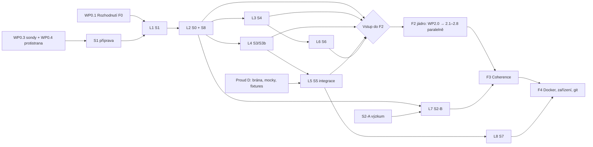

# Ohrádka — implementační plán

Tento dokument převádí [PLAN.md](../PLAN.md) na pracovní balíky, které lze dělat paralelně.
**PLAN.md je autoritativní kontrakt** (požadavky R1–R8, threat model, brány S0–S8, akceptace).
Při rozporu platí PLAN.md; tento dokument se opraví.

- Postupy a pravidla práce: [GUIDE.md](GUIDE.md)
- Stav požadavků, bran, testů a balíků: [COVERAGE.md](COVERAGE.md)
- Rozhodnutí F0: [DECISIONS.md](DECISIONS.md)
- Výsledky bran F1: [spikes.md](spikes.md)

## 1. Principy rozdělení práce

1. **Příprava je paralelní, laboratoř je sériová.** Psaní kódu, sond, skriptů, fixtures a mocků může běžet
   souběžně ve více větvích. Běhy, které mění systém testovacího Macu (uživatelé, Sdílení obrazovky, pf,
   `/opt`, ACL, TCC granty), probíhají po jednom v **laboratorních slotech** (§4). Systémové zásahy
   a úklid se nesmějí překrývat (PLAN §Postup F1).
2. **Privilegované kroky spouští uživatel.** Agent připraví skript s výchozím režimem `--dry-run`, popisem
   změn, záznamem původního stavu a úklidem. Root operace z oblasti neexistují.
3. **Brána ≠ hotový balík.** Balík je hotový, když existuje jeho výstup (kód, skript, sonda). Brána je
   prošlá, až když důkaz splní akceptaci z PLAN.md. Coverage vede oba stavy zvlášť.
4. **Bezpečnostní fail blokuje závislou integraci.** Po failu pokračuje jen nezávislý výzkum bez skutečných
   dat (PLAN §Pořadí). Změna požadavku vyžaduje záznam v DECISIONS.md a výslovné rozhodnutí uživatele.
5. **Vlastnictví adresářů.** Každý balík má vlastní adresář; sdílené kontrakty (`spikes/common/`,
   `Contracts/`) se mění jen samostatným balíkem s review, aby paralelní větve nekolidovaly.

## 2. Role

| Role | Odpovědnost |
|---|---|
| **Uživatel** | Rozhodnutí F0, privilegované kroky v laboratoři, TCC granty, skutečné integrační důkazy (účty, scopes), schválení stahování cizích balíčků konkrétním příkazem, schválení změn kontraktu. |
| **Implementátor** (člověk nebo agent) | Kód, sondy, skripty s dry-run a úklidem, fixtures a mocky, vyhodnocení protokolů, aktualizace coverage. Nečte tajemství, nepouští `sudo`, nespouští nepřezkoumané balíčky. |
| **Reviewer** | Nezávislá kontrola výsledku brány proti PLAN.md (oracle, credentials sond, úplnost failure modes). Brána se neuzavírá bez review. |

## 3. Fáze a pracovní balíky

Značení: `WPx.y`. Sloupec **Paralelně** říká, s čím může balík běžet současně. **Lab** = potřebuje
laboratorní slot (§4). Stav balíků vede [COVERAGE.md §4](COVERAGE.md#4-pracovní-balíky).

### F0 — Rozhodnutí a základy (start okamžitě)

| ID | Balík | Výstup | Závislosti | Paralelně | Lab |
|---|---|---|---|---|---|
| WP0.1 | Rozhodnutí F0 (8 bodů z PLAN §F0) | Vyplněné [DECISIONS.md](DECISIONS.md) | — | vše | ne |
| WP0.2 | Repo, dokumentace, coverage | Tento repozitář, GUIDE, COVERAGE | — | vše | ne |
| WP0.3 | Společná sada sond `spikes/common/` | Swift knihovna + CLI `ohr-whoami`: ověření skutečného/efektivního UID/GID, skupin, audit session a bootstrap kontextu proti očekávání (nesoulad = neplatné měření); generátor syntetických kanárků; formát protokolu běhu | WP0.2 | WP0.4, WP0.5, S5 | ne |
| WP0.4 | Nezávislá protistrana (oracle) | `spikes/common/counterpart`: listener na řízeném hostu, který nezávisle zaznamenává přijaté kanárky/bajty (pro S3, S5, S7) | WP0.3 (formát) | WP0.3, S5 | ne |
| WP0.5 | Metodika měření a laboratoř | `docs/LAB.md`: baseline testovacího Macu (model, RAM, macOS, displeje), záloha před během, acceptance statistiky a délky testů (F0.8) zapsané **před** měřením | WP0.1 (bod 8) | WP0.3, WP0.4 | ne |

**Výstup F0:** rozhodnutí 1–8 zapsaná (nebo výslovně otevřená), sondy umí ověřit vlastní credentials,
protistrana existuje, metodika je zafixovaná. Bez F0 nelze brány F1 vyhodnotit (PLAN §F0).

### F1 — Spiky s branami

Rozděleno do **proudů**. Příprava všech proudů může začít hned po WP0.3; běhy jdou podle §4.

#### Proud A — Relace a hranice (kritická cesta)

| ID | Balík | Výstup | Závislosti | Paralelně | Lab |
|---|---|---|---|---|---|
| WP1.A1 | S1 příprava | `spikes/s1-session/`: `create-users.sh` (3 skrytí uživatelé, `IsHidden`, skupina `ohradka`, hesla do Klíčenky), `probe` (credentials, displeje, Metal, skutečný render, RAM), `observe.sh` (jen povolená metadata), `cleanup.sh`, README | WP0.3 | B, C, D, F-prep | ne |
| WP1.A2 | S1 běh a vyhodnocení | Protokol + verdikt brány S1 v [spikes.md](spikes.md) | WP1.A1, WP0.5 | příprava ostatních | **L1** |
| WP1.A3 | Průzkum výběru virtuální relace (RFB) | Poznámky k protokolu Apple auth + výběru relace; prototyp jen pokud S1 vyžaduje keeper | — | vše | ne |
| WP1.A4 | S0 příprava | `spikes/s0-boundary/`: `xpc-probe`, `tcc-probe`, `capture-probe`, `host-read-probe`, `ingress-probe`, `signing-probe`, `lifecycle-probe` | WP0.3 | B, C, D | ne |
| WP1.A5 | S0 běh a vyhodnocení | Verdikt S0 mapovaný na R2/R3 | WP1.A2 (pass), WP1.A4 | příprava | **L2** |
| WP1.A6 | S8 příprava | `spikes/s8-signing/`: kontrola hardened runtime a absence `get-task-allow`, SMAppService s Personal Team, self-signed varianta, same-UID attach test, fuzzer XPC brokeru | WP0.3 | vše | ne (statické části) |
| WP1.A7 | S8 běh a vyhodnocení | Verdikt S8 | WP1.A2 (pass), WP1.A6 | příprava | **L2** (spolu s S0) |

#### Proud B — Soubory, životní cyklus, rollback

| ID | Balík | Výstup | Závislosti | Paralelně | Lab |
|---|---|---|---|---|---|
| WP1.B1 | Audit hosta (jen metadata) | `spikes/s4-host/audit-host.sh`: kořeny, práva/ACL, sockety, mounty; report rozlišuje pokrytí, nepokryté cesty a drift | WP0.3 | vše | ne (jen čtení metadat) |
| WP1.B2 | Zpevnění a uninstall | `harden-host.sh` (dry-run, záznam původního a nastaveného stavu), `uninstall.sh` (vrací jen vlastní nezměněné zásahy) | WP1.B1 | A, C, D | ne |
| WP1.B3 | Manifest a topologie stavu | Manifest zápisových kořenů (home, projekt, prefix, cache, TMP, později runtime), APFS topologie, mountpointy, kvóty | WP0.3 | vše | ne |
| WP1.B4 | Snapshot/rollback prototyp | Postup snapshot → zapisovatelný obnovený stav → přepnutí, hostem vlastněný recovery záznam, testy pádu v každém kroku | WP1.B3 | A, C, D | ne (vývoj na testovacím svazku) |
| WP1.B5 | S4 běh a vyhodnocení | Verdikt S4 vč. průběžné ochrany, nových mountů, rollbacku a uninstallu | WP1.A5 (pass), WP1.B2, WP1.B4 | příprava | **L3** |

#### Proud C — Síť (pf, ingress)

| ID | Balík | Výstup | Závislosti | Paralelně | Lab |
|---|---|---|---|---|---|
| WP1.C1 | S3 příprava | `spikes/s3-pf/`: šablona anchoru, `load.sh`/`unload.sh`, testy pod UID oblasti, scénáře failure modes (flush, `pfctl -F all`, disable, pád helperu/brány, sleep/wake, VPN, staré states) | WP0.3, WP0.4 | A, B, D | ne |
| WP1.C2 | Návrh ochrany nezávislé na pf | Rešerše a návrh mechanismu, který při ztrátě rulesetu nepustí zakázaná data; pokud neexistuje, zapsat blokátor (ne polling) | — | vše | ne |
| WP1.C3 | S3b příprava | Ingress scénáře: wildcard listenery IPv4/IPv6, host/LAN/jiná oblast, port squatting, pozitivní same-zone server; návrh bind policy | WP1.C1 | A, B, D | ne |
| WP1.C4 | S3/S3b běh a vyhodnocení | Verdikt S3 a S3b s bajty na protistraně | WP1.A2 (testovací uživatelé), WP1.C1, WP1.C3 | příprava | **L4** |

#### Proud D — Typované brány (plně paralelní od začátku)

| ID | Balík | Výstup | Závislosti | Paralelně | Lab |
|---|---|---|---|---|---|
| WP1.D1 | Jádro brány | `spikes/s5-gateway/`: Swift, Network.framework, bez závislostí; HTTP/1.1 + SSE, směrování typed endpointů, SSRF filtr (loopback, RFC1918, link-local, ULA, multicast, `100.64/10`, IP literál, ECH, non-TLS policy) | WP0.3 | vše | ne |
| WP1.D2 | npm typed | Cooldown na úrovni artefaktu (packument i tarball, publish-time, hash, původ, cache, redirect), `PUT`/`DELETE` → 403, cizí `Authorization`, audit stažení | WP1.D1 | D3, D4 | ne |
| WP1.D3 | API modelů | Vkládání klíče, SSE, odmítnutí cizího klíče, rate/budget; mock upstream s testovacím klíčem; per-zone CA pro SDK vyžadující HTTPS | WP1.D1 | D2, D4 | ne |
| WP1.D4 | Fixtures a mocky | Verze před/po hranici cooldownu, scoped packages, neznámé datum, lockfile/`npm ci`, redirect, DNS rebinding, mocky OAuth scopes | WP1.D1 | D2, D3 | ne |
| WP1.D5 | PyPI, Homebrew, git | PyPI simple index + `upload-time`; brew API/bottle domény; git smart HTTP **nebo** per-repo deploy key (rozhodnutí v balíku) | WP1.D2 | D6 | ne |
| WP1.D6 | Matice kompatibility | Matice nástroj × protokol × policy (npm, pnpm, yarn, bun, pip, uv, brew, git, Cargo, Go, Gradle/Maven, NuGet, Conda, RubyGems, SDK, OpenCode, Claude Code, Codex, WebSocket/SSE); nepodporované = nepodporované | WP1.D2 | D5 | ne |
| WP1.D7 | S5 integrační běh a vyhodnocení | Brána přes pf cestu z oblasti, režie ≤ 1,1× dle metodiky, verdikt S5 | WP1.C4 (pass), WP1.D2–D6 | příprava | **L5** |

#### Proud E — Homebrew per oblast

| ID | Balík | Výstup | Závislosti | Paralelně | Lab |
|---|---|---|---|---|---|
| WP1.E1 | S6 příprava | `spikes/s6-brew/`: instalační skript prefixu `/opt/ohr/t001` (spouští uživatel), seznam top 200 formulí, sběr poměru bottle/kompilace, vzorek `brew test`, casky do `~/Applications`, ověření dat publikace pro cooldown | WP1.B3 | vše | ne |
| WP1.E2 | S6 běh a vyhodnocení | Verdikt S6 (stahování schvaluje uživatel konkrétním příkazem) | WP1.B5 (pass), WP1.E1 | příprava | **L6** |

#### Proud F — Coherence

| ID | Balík | Výstup | Závislosti | Paralelně | Lab |
|---|---|---|---|---|---|
| WP1.F1 | S2-A výzkumný prototyp | Ve tvé relaci, bez rootu, jen syntetická okna (TextEdit apod.): ScreenCaptureKit → samostatná proxy okna přes IOSurface, vstup, menu přes AX; více oken, překryvy, skrytá okna, resize, vazba popupů | WP0.3 | vše | TCC grant od uživatele |
| WP1.F2 | S2-B v relaci oblasti | Agent v relaci, IOSurface přes Mach port brokerem, měření tří souběžných oblastí, input-to-photon, supported subset | WP1.A5, WP1.A7 (pass), WP1.F1 | příprava | **L7** |

#### Proud G — Docker

| ID | Balík | Výstup | Závislosti | Paralelně | Lab |
|---|---|---|---|---|---|
| WP1.G1 | Rešerše runtime | Apple `container` vs. Colima/Lima s instancí per oblast vs. vlastní mikro-jádro; budget start/stop (rozhodnutí F0.8 před S7) | WP0.1 | vše | ne |
| WP1.G2 | S7 příprava | `spikes/s7-docker/`: testy `run`/`build`, `-v /:/host`, změna mount konfigurace z oblasti, socket, síť přes bránu, registry auth, published ports, vsock, failure modes | WP1.G1, WP1.D1 | vše | ne |
| WP1.G3 | S7 běh a vyhodnocení | Verdikt S7 | WP1.D7 (pass), WP1.G2 | — | **L8** |

**Vstup do F2 (PLAN §Akceptační kontrakt):** S0, S1, S3/S3b, S4, S5, S6 a S8 prošly ve svém rozsahu.
S2 a S7 nejsou podmínkou F2, ale bez nich F2 nedokazuje R6 ani R4.

### F2 — Jádro (po bráně vstupu do F2)

F2 začíná balíkem kontraktů, aby komponenty mohly vznikat paralelně proti pevným rozhraním.

| ID | Balík | Výstup | Závislosti | Paralelně |
|---|---|---|---|---|
| WP2.0 | Kontrakty | `Contracts/`: XPC schéma helperu a brokeru (pevné, úzké), stavový automat oblasti (vytvořeno → zapínání → běží → pauza → vypínání → vypnuto → úklid), formát politiky sítě a bran, manifest stavu, formát audit logu | brána F2 | — |
| WP2.1 | Helper (system LaunchDaemon) | `Helper/`: uživatelé, APFS svazky, ACL, pf anchory, NATLOOK, autentizace klientů (audit token, podpis, session) | WP2.0 | 2.2–2.8 |
| WP2.2 | Životní cyklus | Zapnutí (ochrany před loginem), bezpečná pauza celého UID, vypnutí (nula procesů, neúspěšný restart), crash recovery, zákaz reuse UID před úklidem | WP2.0 | 2.1, 2.3–2.8 |
| WP2.3 | Stav a rollback | Manifest, snapshot, obnova s recovery záznamem, rollback oblasti vs. rollback projektu | WP2.0 | ostatní |
| WP2.4 | Síť | pf anchory, resolver, brána, hlídač (detektor), změna politiky a obnova (staré states, tunely), ochrana nezávislá na pf dle S3 | WP2.0 | ostatní |
| WP2.5 | Typované brány | Produkční npm/PyPI/brew/git/API modelů, vkládání klíčů z Klíčenky, schvalování svázané s oblastí a operací | WP2.0, WP2.4 (rozhraní) | ostatní |
| WP2.6 | Ohrádka.app | `Ohradka/`: menu bar, schvalování s Touch ID, průvodce zpevněním, audit driftu, uninstall | WP2.0 | ostatní |
| WP2.7 | CLI `ohradka` | `shell`, `run`, `pause`, `snapshot`, `rollback` přes XPC | WP2.0 | ostatní |
| WP2.8 | Únikový test suite | `Tests/Escape/`: automatizace kapitol 1–4 a 7–11 z PLAN §Verifikace, běh ve třech souběžných oblastech | WP2.0 | ostatní |
| WP2.9 | Integrace a brána F2 | Sestavení, běh test suite, verdikt; omezené MVP jen po rozhodnutí F0.2/F0.6 | 2.1–2.8 | — |

### F3 — Coherence (po F2 a S2)

| ID | Balík | Výstup | Závislosti | Paralelně |
|---|---|---|---|---|
| WP3.1 | Agent relace | `SessionAgent/`: capture oken, AX menu, vstup, hlášení procesů a portů; hardened runtime, bez `get-task-allow` | WP2.0, S2 | 3.2–3.5 |
| WP3.2 | Broker frames/input | `Broker/`: Mach port IOSurface, autentizace, fuzzing | WP2.0 | 3.1, 3.3–3.5 |
| WP3.3 | Proxy appky v Docku | Bundle per appka a oblast s odznakem, okna, zrcadlení menu do menu baru | WP3.1, WP3.2 (rozhraní) | 3.4, 3.5 |
| WP3.4 | Most schránky | Preview + potvrzení, karanténa, žádná automatická synchronizace | WP3.1 | ostatní |
| WP3.5 | Rozšířené interakce | Samostatné návrhy: notifikace, file open/save, drag & drop, secure input, tisk, audio | WP3.1 | ostatní |
| WP3.6 | Brána F3 | Escape kapitoly 2 a 8, výkon dle design card, tři instance stejné appky | 3.1–3.5 | — |

### F4 — Docker, zařízení, git (po F2/F3)

| ID | Balík | Výstup | Závislosti | Paralelně |
|---|---|---|---|---|
| WP4.1 | Docker runtime per oblast | `Docker/` dle verdiktu S7 | S7, WP2.4 | 4.2, 4.3 |
| WP4.2 | Zařízení | iOS (usbmuxd) a Android (adb, vlastní port per oblast) jen s výslovným oprávněním oblasti | WP2.1 | 4.1, 4.3 |
| WP4.3 | Git identita | Per-repo deploy key v oblasti, nebo SE klíč držený bránou (dle WP1.D5) | WP2.5 | 4.1, 4.2 |
| WP4.4 | Brána F4 | Escape kapitola 5, pozitivní testy kapitoly 6 | 4.1–4.3 | — |

## 4. Laboratorní sloty (sériové běhy)

Běhy měnící systém se plánují do slotů. Slot začíná zápisem do `docs/LAB.md` (kdo, co, kdy, záloha)
a končí úklidem ověřeným `observe`/`audit` skriptem. Dva sloty nikdy neběží souběžně.

| Slot | Obsah | Předchozí podmínka |
|---|---|---|
| L1 | S1: tři testovací relace | F0, WP1.A1, WP0.5 |
| L2 | S0 + S8 v relacích z L1 | S1 prošla |
| L3 | S4: zpevnění, mounty, rollback, uninstall | S0 prošla |
| L4 | S3/S3b: pf a ingress | testovací uživatelé z L1, S0 prošla |
| L5 | S5 integrace přes pf | S3/S3b prošly |
| L6 | S6: Homebrew per oblast | S4 prošla |
| L7 | S2-B: Coherence v relacích oblastí | S0 a S8 prošly |
| L8 | S7: Docker | S5 prošla, budget rozhodnutý |

## 5. Graf závislostí

## 6. Doporučené paralelní obsazení na start

Tyto balíky lze rozdat současně hned po prvním commitu (každý do vlastní větve, viz GUIDE §5):

1. **WP0.1** — uživatel vyplní DECISIONS.md.
2. **WP0.3 + WP0.4** — společné sondy a protistrana (blokují přípravu ostatních běhů, proto první).
3. **WP1.D1 → D2/D3/D4** — typovaná brána s mocky (nepotřebuje laboratoř).
4. **WP1.B1, WP1.B3** — audit metadat a manifest stavu.
5. **WP1.C2** — rešerše ochrany nezávislé na pf (největší otevřený síťový blokátor).
6. **WP1.A3, WP1.G1** — průzkum RFB a Docker runtime.

Jakmile je hotové WP0.3, přidat WP1.A1, WP1.A4, WP1.A6, WP1.C1 a WP1.F1.
